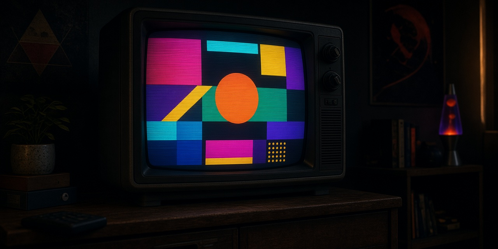

<p align="center">
  
</p>
<p align="center"><em>A static site generator in OCaml: markdown in, a DAG of transforms, HTML out.</em></p>

# crt

> Static site generator that treats content as a signal pipeline — markdown in, processed through a functional DAG of transforms, HTML out.

**Language:** OCaml  
**Constraint:** Text is the universal interface  
**Stack:** dune, menhir, custom markdown parser, tyxml

---

## Features

- Markdown input with YAML frontmatter
- Functional DAG transform pipeline
- Each node: pure function (parse → highlight → toc → linkcheck → minify)
- Hot reload via file watcher
- Incremental builds (only changed nodes)
- Plugin system (OCaml modules)
- Theme engine with template inheritance

---

## Development Plan

- [x] Phase 1: Markdown parser (menhir grammar)
- [x] Phase 2: DAG pipeline engine (functional composition)
- [x] Phase 3: Core transforms: parse, highlight, toc
- [x] Phase 4: HTML generation (tyxml)
- [x] Phase 5: File watcher + hot reload
- [x] Phase 6: Incremental build cache
- [x] Phase 7: Plugin system (dynamic module loading)
- [x] Phase 8: Theme engine and template inheritance

---

## Getting Started

### Prerequisites

- OCaml toolchain

### Build

```bash
dune build
```

### Test

```bash
dune test
```

### Run

```bash
dune exec crt
```

---

## Architecture

See `PLAN.md` for detailed architecture decisions and implementation notes.

---

## License

Apache-2.0

---

## ☕ Support the Developer

If this project saved you time, solved a problem, or just made your day a little more neon, you can fuel the next one:

[](https://buymeacoffee.com/synthalorian)

---

<p align="center">
  <br>
  <sub>Built by <a href="https://github.com/synthalorian">the synthalorian</a></sub>
  <br><sub>AI-assisted art: the banner image at the top of this README was made with AI image tools. The synthalorian sprite is code-drawn pixel art.</sub>
</p>
